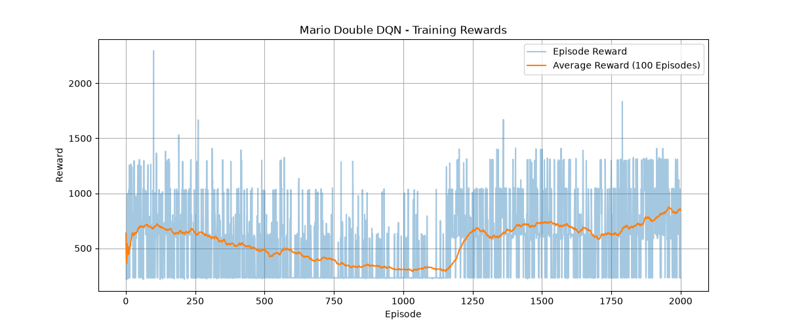
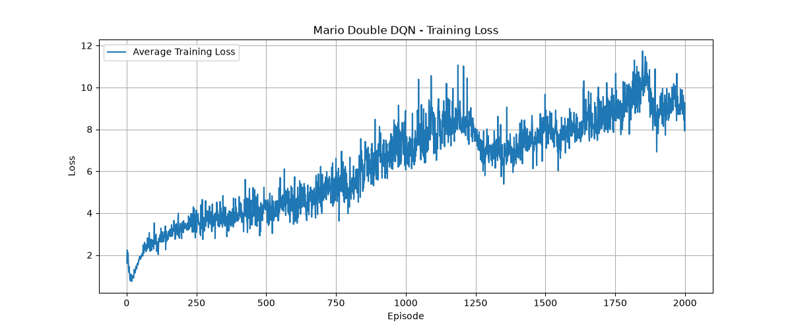

# Mario Double DQN Agent

A Reinforcement Learning project that trains an AI agent to play **Super Mario Bros.** using **Double Deep Q-Network (Double DQN)**.

The agent learns to interact with the game environment through trial and error, using a convolutional neural network to estimate Q-values and select actions that maximize cumulative rewards.

---

## Project Overview

This project implements a Double DQN-based reinforcement learning agent that learns to play Super Mario Bros. using visual game observations.

The agent receives processed game frames as input, predicts Q-values for available actions, and gradually improves its gameplay through experience replay and target network updates.

Two training experiments were conducted:
- **100 Episodes:** Produced the better-performing final model.
- **2,000 Episodes:** Conducted as an extended training experiment to study learning behavior and performance.

After evaluation, the 100-episode model was selected as the final checkpoint because it achieved better results in the tested environment.

## Key Features

- Double Deep Q-Network (Double DQN) implementation.
- Convolutional Neural Network (CNN) for visual state processing.
- Experience Replay Buffer for learning from past transitions.
- Target Network for more stable Q-value estimation.
- Epsilon-Greedy exploration strategy.
- Frame skipping and frame stacking.
- Grayscale conversion and image resizing.
- Training metrics logging.
- Reward and loss visualization.
- Greedy evaluation of trained models.
- Fullscreen gameplay using the trained agent.

---

## Double DQN Architecture

Double DQN is an extension of Deep Q-Network (DQN) designed to reduce the overestimation of action values.

It uses two neural networks:

1. **Policy Network:** Predicts Q-values and selects the best next action.
2. **Target Network:** Evaluates the Q-value of the action selected by the policy network.

### Learning Workflow

1. The agent receives the current game state.
2. The policy network predicts Q-values for all available actions.
3. An action is selected using the epsilon-greedy strategy.
4. The environment executes the action and returns the next state, reward, and termination information.
5. The transition is stored in the replay buffer.
6. A batch of transitions is sampled from the replay buffer.
7. The policy network selects the best next action.
8. The target network evaluates that selected action.
9. The predicted Q-values are updated using the loss between predicted and target values.
10. The target network is periodically synchronized with the policy network.

### Double DQN Target

The target value is calculated as:

\[
Y_t = r_t + \gamma Q_{\text{target}}
\left(s_{t+1}, \arg\max_a Q_{\text{policy}}(s_{t+1},a)\right)
\]

Where:

- \(r_t\): Immediate reward.
- \(\gamma\): Discount factor.
- \(Q_{\text{policy}}\): Policy network.
- \(Q_{\text{target}}\): Target network.
- \(s_{t+1}\): Next state.

For terminal transitions, the future Q-value contribution is zero.

### Core Components

| Component | Description |
|---|---|
| Policy Network | Predicts Q-values for available actions |
| Target Network | Provides stable target Q-value estimates |
| Experience Replay | Stores and samples previous transitions |
| Epsilon-Greedy | Balances exploration and exploitation |
| CNN | Extracts visual features from game frames |
| Optimizer | Updates policy network parameters |
| Smooth L1 Loss | Measures prediction error during training |

---

## Environment and State Processing

The Mario environment is created using `gym-super-mario-bros`.

To simplify the learning problem, the original game observations are preprocessed before being passed to the neural network.

The preprocessing pipeline includes:

- **Frame Skipping:** Executes each selected action for multiple frames.
- **Grayscale Conversion:** Converts RGB frames into grayscale images.
- **Resizing:** Resizes observations to 84 × 84 pixels.
- **Frame Stacking:** Combines four consecutive frames to provide temporal information.

The final state representation has the shape:

`(4, 84, 84)`

The agent uses two available actions:

- Move right.
- Move right and jump.

---

## Project Structure

```text
Mario-Double-DQN-Agent/
│
├── agent.py
├── dqn.py
├── environment.py
├── experience_replay.py
├── train.py
├── play.py
├── plot_training.py
│
├── parameters.yaml
├── requirements.txt
│
├── test_agent.py
├── test_config.py
├── test_mario.py
├── test_optimize.py
├── test_replay.py
│
├── training_metrics.csv
├── training_metrics_100ep.csv
│
├── reward_curve.png
├── training_loss.png
│
├── README.md
└── .gitignore
```

**Note:** Model checkpoint files (`.pth`) and training metric CSV files are excluded from the GitHub repository through `.gitignore`. The CSV files are retained locally for experiment tracking.

---

## Installation and Setup

### 1. Clone the Repository

```bash
git clone https://github.com/kratika-agg/Mario-Double-DQN-Agent-.git
cd Mario-Double-DQN-Agent-
```

### 2. Create a Virtual Environment

```bash
python -m venv .venv
```

Activate the environment:

**Windows PowerShell**

```powershell
.\.venv\Scripts\Activate.ps1
```

### 3. Install Dependencies

```bash
python -m pip install -r requirements.txt
```

### 4. Verify Configuration

```bash
python test_config.py
```

### 5. Train the Agent

```bash
python train.py
```

Training metrics are recorded in `training_metrics.csv`, and the trained checkpoint is saved locally.

### 6. Generate Training Graphs

```bash
python plot_training.py
```

This generates:

- `reward_curve.png`
- `training_loss.png`

### 7. Run the Trained Agent

```bash
python play.py
```

**Important:** The trained model checkpoints are not included in this repository. The gameplay script expects `mario_double_dqn_100ep.pth` in the project root.

To run the selected trained model, place that checkpoint in the project directory. Alternatively, run training locally to generate a checkpoint, then update the checkpoint filename in `play.py` if necessary.

---

## Training Experiments and Results

Two experiments were conducted to compare the agent's learning behavior and gameplay performance.

### Experiment 1: 100 Episodes

Configuration:

- Training episodes: 100
- Exploration strategy: Epsilon-Greedy
- Evaluation episodes: 5
- Evaluation mode: Greedy (`epsilon = 0`)

**Evaluation Results**

| Metric | Result |
|---|---:|
| Average Reward | 615 |
| Average Steps | 114 |
| X Position | 694 |
| Flag Reached | False |

The agent demonstrated better gameplay performance in this experiment, reaching a further position in the level and achieving a higher reward.

### Experiment 2: 2,000 Episodes

Configuration:

- Training episodes: 2,000
- Exploration strategy: Epsilon-Greedy
- Evaluation episodes: 5
- Evaluation mode: Greedy (`epsilon = 0`)

**Evaluation Results**

| Metric | Result |
|---|---:|
| Average Reward | 231 |
| Average Steps | 40 |
| X Position | 296 |
| Flag Reached | False |

The extended training experiment showed variations in reward throughout training. However, its final greedy evaluation performance was lower than that of the 100-episode model.

---

## Training Visualizations

The following graphs represent the **2,000-episode training experiment**.

### 1. Training Reward Curve

The reward curve illustrates the agent's reward progression during training. The average reward is calculated using a rolling window of the latest 100 episodes.



### 2. Training Loss Curve

The loss curve illustrates changes in the average training loss across episodes.



---

## Model Comparison

Both trained models were evaluated over five greedy evaluation episodes.

| Evaluation Metric | 100 Episodes | 2,000 Episodes |
|---|---:|---:|
| Average Reward | **615** | 231 |
| Average Steps | **114** | 40 |
| X Position | **694** | 296 |
| Flag Reached | No | No |

### Final Model Selection

The **100-episode model** was selected as the final model because it achieved:

- Higher evaluation reward.
- Greater horizontal progress.
- More gameplay steps before termination.

The 2,000-episode experiment was retained as a comparison to study how extended training affected the agent's performance.

**Observation:** More training episodes do not automatically guarantee better performance. Learning rate, exploration strategy, reward structure, and training stability can all influence the final policy.

Neither model successfully completed the level during the reported evaluations.

---

## Technologies Used

- Python
- PyTorch
- Gymnasium / OpenAI Gym ecosystem
- Gym Super Mario Bros.
- NumPy
- Matplotlib
- PyYAML
- Reinforcement Learning
- Deep Q-Learning
- Double DQN
- Convolutional Neural Networks

---

## Future Improvements

- Improve training stability and Q-value convergence.
- Experiment with different learning rates and exploration schedules.
- Train the agent to complete the full level.
- Evaluate performance across multiple random seeds.
- Explore more advanced reinforcement learning algorithms.

---

## Learning Outcomes

Through this project, I explored and implemented:

- Reinforcement Learning fundamentals.
- Yaml configuration.
- Deep Q-Networks and Double Deep Q-Networks.
- CNN-based visual state processing.
- Experience Replay and Target Networks.
- Epsilon-Greedy exploration.
- Model training and evaluation.
- Training metric tracking and visualization.
- Experiment comparison and performance analysis.

---

## Author

**Kratika Agrawal**

GitHub: [kratika-agg](https://github.com/kratika-agg)

---

*Built as a hands-on exploration of Deep Reinforcement Learning and Double DQN.*
